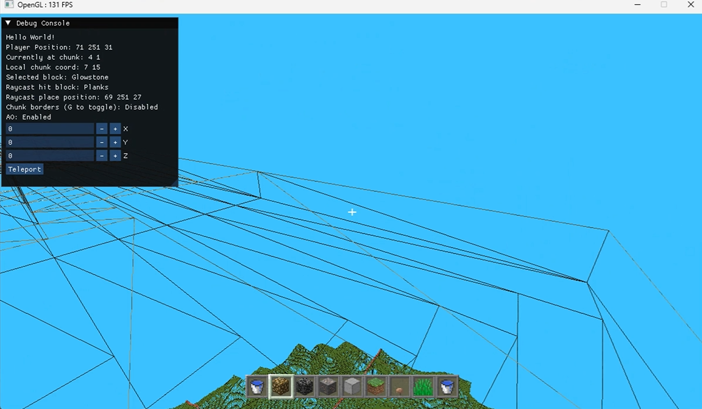

# CrabbyGL — C++ Voxel Engine

> A Minecraft-inspired voxel engine built entirely from scratch in **C++ and OpenGL 3.3**


---

## Introduction

CrabbyGL is a fully custom voxel world engine: no game engine, no Unity, no Godot, no
rendering framework. Every system is written from scratch: chunk streaming, greedy mesh
building, flood-fill lighting, fluid simulation, AABB physics, disk persistence, the UI, and
the entire rendering pipeline.

The goal: understand how Minecraft actually works by building each piece myself.

---

## Demo


https://github.com/user-attachments/assets/93e80bbe-9ec6-4425-82a5-5f04bee6d503

---

## Benchmarks

Measured with in-engine instrumentation, not eyeballed from a frame counter.

| Metric | Result |
|---|---|
| **Greedy meshing** | **58% fewer quads** (2.4×) — beyond exposed-face culling alone |
| **GPU memory** | **11.8 MB → 4.7 MB** of vertex data for the same geometry |
| **Frustum culling** | **57.8% of loaded chunks discarded per frame** — 197 → 83 draw calls |
| **Frame time** | **262 FPS average, 140 FPS 1% low** (p99 = 7.2 ms, 9,715-frame capture) |

Done at a view distance of 8 chunks.

The baseline for "58% fewer quads" is faces that **already survived exposed-face culling**,
not all six faces of every cube. It measures the merging win in isolation.

---

## Binary Greedy Meshing

Instead of emitting one quad per visible block face, coplanar faces are merged into the
largest possible rectangles. Each layer is scanned into a `uint16_t` bitmask per row, and
runs are found with a hardware count-trailing-zeros instruction:

```cpp
const int col = std::countr_zero(mask);   // O(1) jump to next unmeshed face
```

Faces merge only when **every** visual property matches — block type, all four AO values,
overlay flag, quad-flip orientation, and light level — packed into a single 32-bit key:

```cpp
key = type | (ao[0..3] << 8) | (useOverlay << 16) | (flip << 17) | (lightValue << 18);
```

### Seeing it work: the glowstone test

The merge key makes the optimization directly visible. Wireframe mode (`J`) shows the actual
triangles being rendered:

| Uniform light — fully merged | Glowstone added — merging breaks down |
|---|---|
|  |  |

**Left:** a flat platform under uniform sky light. Every block shares the same light level, so
the entire surface collapses into a handful of large quads — the wireframe shows only a few
enormous triangles spanning many blocks.

**Right:** the same platform after placing a **glowstone** block. Block light falls off by one
level per block from the source, so each ring of blocks around it now carries a *different*
light value. Different light value means a different merge key, which means **no two
neighbouring faces can merge** — the wireframe collapses into a dense per-block grid.

This is correct behaviour, not a bug: merging across differing light levels would destroy the
lighting gradient. It's the fundamental trade-off of greedy meshing, merge rate is bounded by
how much per-face variation your shading model carries. Large uniform surfaces (the common
case) merge perfectly; lit, detailed areas fall back toward one quad per face.

---

## Features

### Infinite World Streaming

The world is split into **16 × 256 × 16 block chunks** (65,536 blocks each). As the player
moves, new chunks are generated in the background and distant ones are unloaded.

- View distance **8 chunks**, unload distance **12** — the gap is hysteresis, so standing on a
  chunk boundary doesn't thrash load/unload
- Chunks live in a hash map keyed by `(chunkX, chunkZ)` with a Murmur3-style hash, since
  sequential grid coordinates cluster badly under naive hashing
- ~512 KB per chunk resident: 64 KB blocks + 64 KB light + 384 KB cached AO

### Multithreaded Architecture

```
OS Main Thread          → GLFW event polling, keyboard state, window title
Renderer Thread         → owns the OpenGL context AND the world state:
                          physics tick, lighting BFS, streaming, mesh upload, draw

  Load Workers   (×4)   → Perlin terrain generation + disk reads
  Mesh Workers   (×4)   → greedy mesh building (CPU only)
  Save Worker    (×1)   → binary chunk writes (never blocks the frame)
```

A deliberate design point: the **renderer thread owns the world**, not the OS main thread. The
main thread does nothing but pump GLFW events and publish input through a mutex-guarded key
buffer and atomics. This keeps the entire world state single-owner, so no world data structure
needs locking against the frame loop.

Worker safety rests on two mechanisms:

- **Per-chunk `std::shared_mutex`** — many mesh workers read a chunk concurrently; block edits
  take it exclusively
- **Staging handoff** — workers never touch live world containers. They push into staging maps
  that the renderer thread swaps out wholesale, so the critical section is a single pointer
  swap, O(1), regardless of how much work was produced

Chunk lifetime is protected by a **neighbour-aware refcount**: a mesh job captures raw
pointers to a chunk *and its 8 neighbours*, and all nine are pinned against unload until the
job completes.

### Flood-Fill Lighting

Minecraft-style BFS propagation, with separate queues for propagation and removal:

- **Sky light** and **block light** packed into one byte — high nibble sky, low nibble block
- Sunlight propagates **downward without attenuation** in open columns, so vertical shafts stay
  full brightness; horizontal spread attenuates by one level per block
- Removal handles the hard case correctly: when a neighbour's level is ≥ the removed light, it's
  an independent source, so removal stops and re-propagation begins there instead
- Light crosses chunk boundaries, seeding from neighbour edges on load

Glowstone emits level 15. This is what drives the merge-key demonstration above.

### Ambient Occlusion

Per-vertex AO using the standard voxel method — each corner samples three neighbours in the
face plane:

```
ao = (side1 && side2) ? 0 : 3 - side1 - side2 - corner
```

Quads are **flipped** along the other diagonal when the AO gradient would otherwise produce the
classic anisotropy artifact. AO sampling reaches all 8 surrounding chunks (4 axial + 4
diagonal), and results are cached per face and invalidated only when the neighbourhood actually
changes.

### Water Simulation

Fluid dynamics on a **20 TPS fixed-step accumulator**, decoupled from frame rate:

- **Source** vs **flowing** water, with a spread level 7 → 0 decaying one per block
- Falling takes priority over spreading; when spreading, directions that lead to a drop are
  preferred over flat ones, so water finds edges the way it should
- A removal BFS cascades when a source is destroyed
- Rendered in a separate blended pass with depth writes disabled

### Rendering Pipeline

```
1. Bind off-screen framebuffer
2. Frustum cull    → Gribb/Hartmann plane extraction, per-chunk AABB test
3. Opaque pass     → one draw call per visible chunk
   ├── Vertex shader   → UBO-shared view/projection, unpack normal/AO/overlay bits
   └── Fragment shader → atlas sample, grass overlay blend, directional face shading,
                          AO darkening curve, sky+block light, distance fog
4. Water pass      → alpha-blended, depth-write off
5. UI pass         → hotbar, inventory, crosshair, text (depth test off)
6. Blit framebuffer → screen
```

Vertices are packed to exactly **32 bytes** — position, tile-local UV, two atlas tile indices,
a bit-packed byte (face normal, overlay flag, AO), a light byte, and an RGBA8 tint.

### UI System — Written From Scratch

The entire in-game interface is hand-built OpenGL. **Dear ImGui is used only for the developer
debug overlay** — none of the game UI touches it.

- **Bitmap font renderer** — text drawn from an ASCII atlas, with a bold variant
- **Hotbar** with selector cursor and live block icons
- **Full inventory screen** — click to pick up, click to place, drag item follows the cursor,
  slot-under-mouse hit testing, hover highlight, `Q` to drop
- **Icon rendering** straight from the block atlas, so a new block type gets an inventory icon
  for free
- Orthographic projection, per-widget VAO/VBO/EBO, inventory persisted to disk between sessions

### Player Physics

Custom AABB collision — no physics library.

- **Axis-separated resolution: X → Y → Z**, which prevents corner-locking
- Epsilon-contracted sweeps so the player doesn't catch on exact block boundaries
- Gravity, jumping, terminal velocity, sprint, and a fly mode toggled by double-tapping Space
- **DDA raycasting** for block targeting — exact integer grid traversal, no sampling error

### Disk Persistence

Chunks serialize to `saves/cx_cz.bin`, where `cx_cz` are the chunk coordinates. Modified chunks are handed to the save worker on unload,
so the frame loop never waits on disk I/O.

- `dirty` → needs a mesh rebuild
- `modified` → has unsaved block changes

### Data-Driven Block Registry

Block behaviour is data, not code. There is **no `switch` statement in the mesh builder** — it
all reads from `GetDef(type)`:

```cpp
struct BlockDef {
    const char* name;
    int         faces[6];       // atlas tile per face (±Y, ±X, ±Z)
    int         overlay;        // secondary layer (grass sides)
    glm::vec4   tint;           // colour multiplier
    uint16_t    flags;          // OPAQUE | SOLID | TRANSPARENT | TRANSLUCENT | CROSS | WATER
    float       hardness;
    bool        useOverlay;
    uint8_t     lightEmission;  // glowstone = 15
};
```

A `static_assert` keeps the table in sync with the `BlockType` enum, so adding a block without
defining it fails at compile time. **29 block types** currently: terrain, ores, flora (rendered
as crossed quads), glass, glowstone, and both water types.

---

## Technical Stack

| | |
|---|---|
| Language | C++23 |
| Graphics API | OpenGL 3.3 Core |
| Math | GLM |
| Windowing | GLFW |
| Image loading | stb_image |
| Noise | stb_perlin |
| Debug overlay | Dear ImGui *(debug only — game UI is from scratch)* |
| Build | Visual Studio 2022 |

---

## Building

1. Clone the repo
2. Open `CrabbyGL.sln` in **Visual Studio 2022**
3. Set configuration to `Release`, platform `x64`
4. **Build → Build Solution** (`Ctrl+Shift+B`)
5. Run from the project root so relative asset paths (`assets/`) resolve

> **Requirements:** Visual Studio 2022, a GPU supporting OpenGL 3.3

---

## Controls

| Key | Action |
|---|---|
| `W` `A` `S` `D` | Move |
| `Space` | Jump / fly up |
| `Space` ×2 | Toggle fly mode |
| `Left Shift` | Fly down |
| `Left Ctrl` | Sprint |
| `Left Click` | Break block |
| `Right Click` | Place block |
| `Middle Click` | Pick block into hotbar |
| `Scroll` | Cycle hotbar |
| `E` | Open / close inventory |
| `Q` | Drop held item |
| `C` *(hold)* | Zoom |
| `G` | Toggle chunk borders |
| `H` | Toggle ambient occlusion |
| `J` | Toggle wireframe |
| `P` | Pause |
| `Home` | Reset camera |

---

## Project Structure

```
CrabbyGL/
├── src/
│   ├── Main.cpp                  # Game loop, input, render orchestration
│   ├── core/
│   │   ├── OpenGL_3D.cpp         # Window, renderer thread, input plumbing
│   │   └── Camera.cpp            # View matrix, mouse look
│   ├── world/
│   │   ├── World.cpp             # Streaming, worker pools, save/load, draw
│   │   ├── Chunk.cpp             # Block storage, per-chunk mutex, serialization
│   │   ├── ChunkMeshBuilder.cpp  # Binary greedy meshing, AO, face culling
│   │   ├── LightingSystem.cpp    # Sky + block light BFS
│   │   ├── BlockRegistry.cpp     # Block definition table
│   │   └── Raycast.cpp           # DDA voxel traversal
│   ├── physics/
│   │   └── WorldPhysics.cpp      # 20 TPS tick, water flow, gravity blocks
│   ├── player/
│   │   ├── Player.cpp            # AABB collision, movement
│   │   └── Inventory.cpp         # Slots, drag-and-drop, persistence
│   └── rendering/
│       ├── ChunkMesh.cpp         # VAO/VBO management, attribute layout
│       ├── UIRenderer.cpp        # Hotbar, inventory, text, icons
│       └── Shader.cpp            # Compilation, uniform location caching
├── assets/
│   ├── shaders/                  # ChunkMesh, WaterMesh, UI, framebuffer
│   └── textures/                 # Block atlas, UI sprites, ASCII font
└── includes/                     # Headers
```

---

## Roadmap

### Done
- [x] Infinite chunk streaming with worker thread pools
- [x] **Binary greedy meshing** with AO- and light-aware merge keys
- [x] **BFS sky and block light propagation** with correct removal
- [x] Exposed-face culling with cross-chunk seam handling
- [x] Gribb/Hartmann frustum culling
- [x] Ambient occlusion with anisotropy quad flip
- [x] Water simulation — sources, flow, spread levels, 20 TPS tick
- [x] AABB physics with axis-separated resolution
- [x] DDA raycasting for block targeting
- [x] Hand-built UI — hotbar, inventory, drag-and-drop, bitmap text
- [x] Data-driven block registry (29 types)
- [x] Binary disk persistence, non-blocking saves
- [x] Texture atlas with per-face UV mapping, grass overlay blending
- [x] Distance fog, framebuffer post-process pass
- [x] Cross-shaped flora and translucent block rendering

### Next
- [ ] **Day / night cycle** — animated sun direction and sky colour, time-varying sky light
- [ ] **Richer world generation** — caves, biomes, more varied terrain
- [ ] **CMake build** — replacing the Visual Studio solution for cross-platform builds
- [ ] **Emscripten port** — playable in the browser via WebGL
- [ ] **Mobs and an ECS** *(far future)* — entity-component architecture to support AI

---

## Why build this?

Minecraft's rendering and world management look simple on the surface but hide a lot of depth —
chunk threading, seam culling, ambient occlusion, staged handoff between workers and the
renderer, flood-fill lighting, DDA traversal. Building it from scratch forces you to actually
understand each system instead of calling an API that hides it.

Every system here is implemented from the ground up, with no engine or abstraction layer
between the code and the GPU.

Built as a hobby project.

---

*Inspired by Minecraft (Mojang). Not affiliated with or endorsed by Mojang or Microsoft.*
